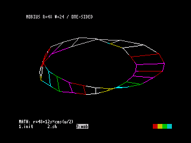
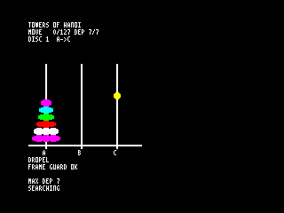
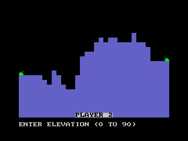
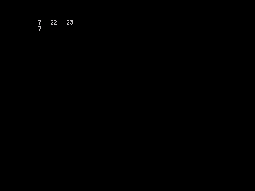
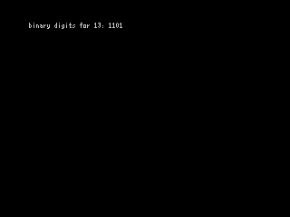
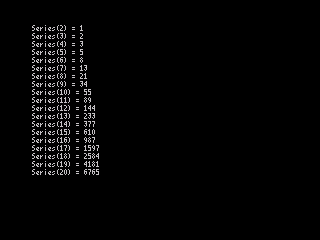

# ZX-UX — The ZX Spectrum 48K Unix Project

At SANYALnet Labs, we built ZX-UX as a serious Unix-like operating system for the Sinclair ZX Spectrum 48K.

The target machine has 48K of RAM, a Z80 processor, and very little room for architectural hand-waving. We gave it processes, preemptive multitasking, `fork`, `exec`, system calls, an inode-based ramfs-like filesystem, relocatable programs, and active memory management.

The Z80 has work to do. We made sure it has a shell while doing it.

ZX-UX is Unix-like in its kernel structure and operating model. That label describes its architecture and behavior; it does not claim historical Unix source or binary compatibility.

## Read the Book First

Before reading the source, read:

**[The Design of the ZX-UX Operating System](docs/Design_of_the_ZX-UX_Operating_System.pdf)**

The book explains the kernel, process model, filesystem, loader, memory manager, SDK, and development workflow.

The source will still be there afterward. It has nowhere else to go.

## Start with the Multitasking Demo

The repository includes the ZX-UX system tape and prebuilt `hanoi` and `queens8` programs.

Use the FUSE emulator for the first session. Set it to a plain Spectrum 48K with the original 48K ROM. Disable `Auto-load media`, `Fastloading`, and `Use tape traps` in the media options. Disable `Accelerate loaders` too, if that option is present. These settings let ZX-UX handle its own cassette loading.

Open `zx-ux/tzx/ZX-UX.tzx` in FUSE by dragging it onto the window or choosing `Media > Tape > Open`. At the BASIC prompt, type:

```text
LOAD ""
```

Press F8 to start tape playback. FUSE first loads the normal Spectrum tape blocks, then hands the remaining boot to the ZX-UX loader. When loading finishes, the login prompt appears.

Enter a short login name, for example:

```text
login: clive
#
```

The `#` prompt is the ZX-UX shell. Check the initial process table:

```text
ps
```

Now mount `assets/c48-bin/tzx/hanoi.tzx` in FUSE. Enter the command below before pressing F8:

```text
# /dev/cassette/hanoi&
<hanoi-pid>
```

The shell starts the program in the background and prints its PID. Write that number down. Press F8 to play the mounted tape. Hanoi begins drawing while the shell remains available.

Press ENTER for a fresh shell line. Replace the mounted tape with `assets/c48-bin/tzx/queens8.tzx`, then enter:

```text
# /dev/cassette/queens8&
<queens8-pid>
```

Press F8 again. Eight Queens starts on the other side of the display while Hanoi continues. The programs do not take turns by agreement; the kernel switches between them using the 50 Hz clock.

Use `ps` to see both PIDs, then stop the demonstrations without resetting the machine:

```text
# kill <hanoi-pid>
# kill <queens8-pid>
```

Record the actual PIDs printed by your session rather than copying the placeholders. The four-slot process table is a hard limit, which is the machine being precise about its memory budget.

This is preemptive multitasking in a useful form: two programs run while the shell remains available for more commands.


## Loading ZX-UX

The system tape is:

```text
zx-ux/tzx/ZX-UX.tzx
```

The prebuilt demonstration tapes are:

```text
assets/c48-bin/tzx/hanoi.tzx
assets/c48-bin/tzx/queens8.tzx
```

An emulator can load these TZX files using its normal cassette controls. A real ZX Spectrum can use the same images through compatible tape-transfer hardware.

The SDK tape writer, `rtap`, can append ZX-UX programs to an existing system tape. The cassette is slow, but it is consistent. It never pretends to be broadband.

## Why ZX-UX Is Unix-Like

We use “Unix-like” to describe the way ZX-UX organizes processes, files, memory, and system calls.

### Processes and preemptive multitasking

Each process has a process ID and kernel-managed process state.

ZX-UX provides:

- preemptive scheduling;
- process creation through `fork`;
- program replacement through `exec`;
- process termination and waiting;
- process inspection through `ps`;
- process termination through `kill`;
- CPU accounting and process-state tracking.

Timer activity allows the kernel to interrupt a running process and give another process time to run. Programs do not need to volunteer before the next program gets a turn.

### System calls

User programs enter the kernel through system calls.

The system-call interface provides operations for:

- process control;
- opening, reading, writing, and closing files;
- creating and removing filesystem entries;
- terminal control;
- timing and sleeping;
- process signals;
- ZX Spectrum and ZX-UX services.

This keeps privileged work inside the kernel while giving programs the services they need.

### A ramfs-like inode filesystem

The filesystem lives in RAM and uses inode-style records for files and directories.

It supports Unix-like operations, including:

- path lookup;
- directories;
- file creation and removal;
- reading and writing;
- links;
- permissions;
- filesystem statistics;
- device-like entries.

On a 48K Spectrum, storing a filesystem in memory is less a design preference than a direct conversation with reality.

### Loading, relocation, and memory management

ZX-UX programs are relocatable executables.

The loader finds a program, allocates memory, applies relocation information, prepares process state, and starts the program under kernel control. Programs do not need to assume one permanent address in memory.

The memory manager also supports:

- background memory compaction;
- elastic process memory;
- memory lending between processes;
- memory reclamation;
- repacking of occupied memory;
- preservation of process and filesystem state while memory moves.

Memory does not sit quietly in ZX-UX. It gets moved, borrowed, compacted, and asked to make room.

## The ZX-UX SDK

The SDK provides the tools needed to write programs, assemble and link them, create cassette images, and run them in the ZX-UX virtual machine.

The SDK includes:

- compiler frontends;
- the Z80 assembler;
- the relocatable linker;
- runtime libraries;
- include files and headers;
- ZX Spectrum ROM support;
- cassette-image tools;
- the ZX-UX virtual machine.

### The five compilers

| Compiler | Source language | Main output |
|---|---|---|
| `rbc` | Native 48K Spectrum BASIC | ZX-UX `SSX1` executable |
| `rcc` | C48 | Z80 assembly, `SSO1`, then `SSX1` |
| `rfc` | Forth-83-flavoured Forth | Assembly, `SSO1`, `SSX1`, and cassette output |
| `rfortranc` | FORTRAN 77 subset | FORTRAN → C48 → `rcc` → assembler/linker |
| `rpc` | Relocatable Pascal | Assembly, `SSO1`, `SSX1`, and cassette output |

An additional `rb2ct` Sinclair BASIC-to-C48 translator is included as an under-development tool. It is separate from the five primary compilers.

## Included Compiler Source and Galleries

The release includes source programs for all five primary compilers. The source trees contain small demonstrations, games, utilities, graphics programs, and numerical work that can be compiled for ZX-UX and loaded on the Spectrum.

Each gallery below uses a FUSE screenshot of a compiled program. The source filename is shown beneath the image and links directly to its source. The thumbnails stay small so the README remains a manual rather than a museum wall.

### C48 source compiled with `rcc`

[`assets/c48-src/`](assets/c48-src/) contains C48 applications, examples, games, demos, security tests, and sound programs. The C48 compiler turns these sources into native ZX-UX programs.

[Full C48 FUSE gallery](screenshots/c48-bin/fuse/index.html)

<table>
<tr>
<td align='center'><a href='assets/c48-src/demos/mobius.c'></a><br><sub><a href='assets/c48-src/demos/mobius.c'><code>mobius.c</code></a></sub></td>
<td align='center'><a href='assets/c48-src/demos/hanoi.c'></a><br><sub><a href='assets/c48-src/demos/hanoi.c'><code>hanoi.c</code></a></sub></td>
<td align='center'><a href='assets/c48-src/demos/queens8.c'></a><br><sub><a href='assets/c48-src/demos/queens8.c'><code>queens8.c</code></a></sub></td>
<td align='center'><a href='assets/c48-src/demos/torus.c'></a><br><sub><a href='assets/c48-src/demos/torus.c'><code>torus.c</code></a></sub></td>
</tr>
</table>

### Spectrum BASIC source compiled with `rbc`

[`assets/basic-src/`](assets/basic-src/) contains the included BASIC programs, including the 60-program collection, numerical analysis, Granada Publishing material, and programs from The Spectrum Show.

[Full BASIC FUSE gallery](screenshots/rbc-bin/fuse/index.html)

<table>
<tr>
<td align='center'><a href='assets/basic-src/60-programs/01-minelay/01-minelay.bas'></a><br><sub><a href='assets/basic-src/60-programs/01-minelay/01-minelay.bas'><code>01-minelay.bas</code></a></sub></td>
<td align='center'><a href='assets/basic-src/60-programs/10-tanx/10-tanx.bas'></a><br><sub><a href='assets/basic-src/60-programs/10-tanx/10-tanx.bas'><code>10-tanx.bas</code></a></sub></td>
<td align='center'><a href='assets/basic-src/60-programs/25-galaxians/25-galaxians.bas'></a><br><sub><a href='assets/basic-src/60-programs/25-galaxians/25-galaxians.bas'><code>25-galaxians.bas</code></a></sub></td>
<td align='center'><a href='assets/basic-src/60-programs/50-moonlander/50-moonlander.bas'></a><br><sub><a href='assets/basic-src/60-programs/50-moonlander/50-moonlander.bas'><code>50-moonlander.bas</code></a></sub></td>
</tr>
</table>

### Forth source compiled with `rfc`

[`assets/forth-src/`](assets/forth-src/) contains Forth examples and numerical-analysis programs. The `rfc` compiler turns Forth source into ZX-UX assembly and cassette-ready programs.

[Full Forth FUSE gallery](screenshots/forth-bin/fuse/index.html)

<table>
<tr>
<td align='center'><a href='assets/forth-src/numerical-analysis/bisect.fth'></a><br><sub><a href='assets/forth-src/numerical-analysis/bisect.fth'><code>bisect.fth</code></a></sub></td>
<td align='center'><a href='assets/forth-src/examples/calendar.fth'></a><br><sub><a href='assets/forth-src/examples/calendar.fth'><code>calendar.fth</code></a></sub></td>
<td align='center'><a href='assets/forth-src/numerical-analysis/cholesky.fth'></a><br><sub><a href='assets/forth-src/numerical-analysis/cholesky.fth'><code>cholesky.fth</code></a></sub></td>
</tr>
</table>

### FORTRAN source compiled with `rfortranc`

[`assets/fortran-src/`](assets/fortran-src/) contains FORTRAN 77 subset samples, including fundamentals, Burkardt numerical programs, and numerical-analysis examples. `rfortranc` translates the supported FORTRAN source through the C48 compiler path.

[Full FORTRAN FUSE gallery](screenshots/fortran-bin/fuse/index.html)

<table>
<tr>
<td align='center'><a href='assets/fortran-src/samples/fundamentals/bases.f'></a><br><sub><a href='assets/fortran-src/samples/fundamentals/bases.f'><code>bases.f</code></a></sub></td>
<td align='center'><a href='assets/fortran-src/samples/burkardt/f77s_burkgcd.f'></a><br><sub><a href='assets/fortran-src/samples/burkardt/f77s_burkgcd.f'><code>f77s_burkgcd.f</code></a></sub></td>
<td align='center'><a href='assets/fortran-src/samples/burkardt/f77s_burkmean.f'></a><br><sub><a href='assets/fortran-src/samples/burkardt/f77s_burkmean.f'><code>f77s_burkmean.f</code></a></sub></td>
<td align='center'><a href='assets/fortran-src/samples/burkardt/f77s_burkmm.f'></a><br><sub><a href='assets/fortran-src/samples/burkardt/f77s_burkmm.f'><code>f77s_burkmm.f</code></a></sub></td>
</tr>
</table>

### Pascal source compiled with `rpc`

[`assets/pascal-src/`](assets/pascal-src/) contains Pascal samples for arrays, numerical analysis, and the included program set. `rpc` compiles these sources into relocatable ZX-UX programs.

[Full Pascal FUSE gallery](screenshots/pascal-bin/fuse/index.html)

<table>
<tr>
<td align='center'><a href='assets/pascal-src/samples/numerical-analysis/bases/bases.pas'></a><br><sub><a href='assets/pascal-src/samples/numerical-analysis/bases/bases.pas'><code>bases.pas</code></a></sub></td>
<td align='center'><a href='assets/pascal-src/samples/fibarray/fibarray.pas'></a><br><sub><a href='assets/pascal-src/samples/fibarray/fibarray.pas'><code>fibarray.pas</code></a></sub></td>
<td align='center'><a href='assets/pascal-src/samples/numerical-analysis/burkgcd/burkgcd.pas'></a><br><sub><a href='assets/pascal-src/samples/numerical-analysis/burkgcd/burkgcd.pas'><code>burkgcd.pas</code></a></sub></td>
<td align='center'><a href='assets/pascal-src/samples/numerical-analysis/burkmean/burkmean.pas'></a><br><sub><a href='assets/pascal-src/samples/numerical-analysis/burkmean/burkmean.pas'><code>burkmean.pas</code></a></sub></td>
</tr>
</table>

### Supporting tools

| Tool | Purpose |
|---|---|
| `ras` | Assemble Z80 source into relocatable `SSO1` objects |
| `rld` | Link objects and archives into `SSX1` executables |
| `rtap` | Write `SSX1` programs to Spectrum cassette images |
| `rvm` | Boot ZX-UX and run programs in the SDK virtual machine |

The normal build path is:

```text
source code
    ↓
compiler
    ↓
Z80 assembly
    ↓
ras
    ↓
SSO1 relocatable object
    ↓
rld
    ↓
SSX1 executable
    ↓
rtap
    ↓
TZX cassette image
```

## The ZX-UX Virtual Machine

The SDK includes its own virtual machine for development and testing.

`rvm` boots the ZX-UX system tape, starts the operating system, logs in, and runs programs through ZX-UX. It uses the operating system itself rather than replacing the kernel with a host-side system-call imitation.

This gives development programs the same process, filesystem, loader, and shell environment used by the target system.

## Repository Layout

```text
docs/        Design book and technical references
sdk/         Compilers, assembler, linker, libraries, and virtual machine
zx-ux/       Kernel, system programs, and system tape
assets/      Source programs and prebuilt binaries and tapes
screenshots/ Demonstration images
LICENSE      Project license
THIRD-PARTY  Third-party notices
```

See [`docs/README.md`](docs/README.md) for technical references used by the project.

## The Result

ZX-UX gives the ZX Spectrum 48K a Unix-like process model, filesystem, loader, memory manager, shell, and software-development kit.

The machine remains a ZX Spectrum.

That is the constraint. The engineering is the point.
