# ZX-UX — UNIX for the Sinclair ZX Spectrum 48K

**8K KERNEL. PREEMPTIVE MULTITASKING. `inode`-BASED RAMFS. `/dev/` DEVICES. ONE SPECTRUM.**

ZX-UX runs UNIX on the Sinclair ZX Spectrum 48K. Its native Z80 kernel brings preemptive multitasking, an inode-based RAM filesystem, a 64-column terminal and cassette-loaded executables to the original hardware.

**A complete desktop development environment comes with it.** We call it the **ZX-UX SDK** (more below). Five cross-compilers and RVM, a ZX Spectrum virtual machine, let you write and test ZX-UX applications on modern computers, then make cassette images for physical or emulated Spectrums.

## 8K Z80 kernel and UNIX system calls

- **8K kernel** — runs UNIX from just 8,192 bytes of Z80 assembly.
- **41 system-call entries** — provide `fork`, `exec`, `wait`, `open`, `read`, `write`, `link`, `stat` and more.
- **Fixed system-call entry** — accepts calls at `0x6003`, with Z80 registers carrying the call number, arguments and results.
- **Standard UNIX I/O** — provides file descriptors 0, 1 and 2, with byte-stream reads and writes to files and devices.
- **64-column terminal** — displays 24 rows of 4×8-pixel characters and supports raw and canonical input, echo, line editing and BREAK interrupts.

## UNIX processes and an interactive shell

- **Preemptive multitasking** — schedules four process slots using a 50 Hz clock and four-tick round-robin time slices.
- **UNIX process lifecycle** — tracks parent and child PIDs, `fork`, `exec`, exit status, zombie states and `wait`.
- **Classic boot sequence** — `init` starts `getty`, which brings up `login` and then `/bin/sh`.
- **Automatic login respawn** — when a session ends, `init` starts another `getty` and returns to the login prompt.
- **Interactive UNIX shell** — supports foreground and background jobs, `<`, `>`, `>>`, wildcards, quoting, command files and `$0`–`$9` arguments.
- **Built-in `cd` and `exec`** — work within the current process: `cd` changes the directory and `exec` replaces the program.
- **Built-in `kill`** — signals a process without forking, even when all four process slots are occupied.
- **Process tools** — `ps` and `top` inspect running jobs; `sleep` waits on the system clock.
- **Live status row** — shows process names, states, the active process and time at a glance.

## Elastic memory management

- **Reclaimed Spectrum RAM** — uses the printer buffer (`0x5B00`–`0x5BFF`) for kernel globals and process tables.
- **BASIC scratch space, repurposed** — stores keyboard, process and compression state in unused BASIC/Interface 1 workspace and calculator bytes.
- **In-RAM process swapping** — saves process state and exchanges resident-program images as jobs take turns.
- **Relocating compaction** — moves file blocks and saved process images while updating their references.
- **Idle-time LZ77 compression** — packs eligible closed files in the background and yields whenever a process needs the CPU.
- **Transparent unpacking** — restores packed files when a program reads or writes them.
- **Memory-pressure recovery** — compacts RAM, packs eligible files and retries allocations.
- **Window lending** — lends resident-program memory to larger cassette-loaded executables and reclaims it when available.

## Inode filesystem and device files

- **Hierarchical RAM filesystem** — supports directories, hard links, file modes and per-process working directories.
- **24 file inodes** — store RAM-file metadata in compact, 32-byte structures.
- **UNIX file metadata** — records link counts, access modes, sizes and creation/modification times, available through `stat`.
- **Per-process file descriptors** — let programs open, read, write, seek and close files through the kernel.
- **UNIX `unlink` semantics** — keep a file alive after its last directory entry is removed, until the last open handle closes.
- **Devices as files** — expose the terminal through `/dev/tty`, memory through `/dev/mem` and cassette access through `/dev/tap`.

## UNIX commands and cassette-loaded programs

- **32 commands in `/bin`** — include `ls`, `cat`, `cp`, `mv`, `ln`, `rm`, `chmod` and `wc`.
- **Editing and inspection tools** — include `vi`, `more`, `df`, `date`, `stat` and `od`.
- **Cassette execution** — loads and runs native SSX1 programs from the cassette device.
- **Archiving and compression tools** — include `tar`, `tap` and `zxpack`.
- **Spectrum ROM integration** — retains access to the machine's keyboard, sound and cassette routines.

### Try it in FUSE: Hanoi + 8 Queens

Use [FUSE](https://fuse-emulator.sourceforge.net/) for the first session. Set it to a plain Spectrum 48K with the original 48K ROM. Disable **Auto-load media**, **Fastloading** and **Use tape traps** in the media options; disable **Accelerate loaders** too, if FUSE shows that option. ZX-UX has its own cassette loader and prefers to drive.

Open the supplied [ZX-UX system tape](zx-ux/tzx/ZX-UX.tzx) in FUSE by dragging it onto the window or choosing **Media > Tape > Open**. At the Spectrum BASIC prompt, type:

```basic
LOAD ""
```

Press F8 to start tape playback. Once ZX-UX boots, log in as `clive`, `root` or any other username. **No password is required.**

At the UNIX shell, mount the supplied [Hanoi tape](examples/c48-bin/tzx/hanoi.tzx). Type the command before pressing F8 to play the tape:

```sh
/dev/cassette/hanoi&
```

**Note the PID printed when the background job starts.** Leave Hanoi running, replace the mounted tape with the supplied [8 Queens tape](examples/c48-bin/tzx/queens8.tzx), then type the second command before pressing F8 again:

```sh
/dev/cassette/queens8&
```

Note its PID as well. Hanoi animates on the left and 8 Queens searches on the right. The UNIX shell is still running, even with all four process slots occupied. Press Enter to bring back the waiting shell prompt. To stop either job, enter `kill PID`, replacing `PID` with the number you recorded; repeat for the other job. ZX-UX handles `kill` inside the shell, without needing a fifth process.

<p align="center">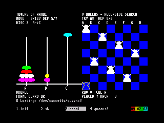</p>

A physical 48K Spectrum can use the same TZX images through compatible tape-transfer hardware.

### ZX-DESK — a graphical UNIX desktop on the Spectrum

**[ZX-DESK](examples/zx-desk-src/)** brings a windowed graphical desktop to ZX-UX, with desktop icons, drop-down menus, overlapping windows, Cascade and Tile views, and a live clock. Its applications include a two-pane file browser, a read-only Notes viewer, an About window and a compact command console. The desktop runs as a native ZX-UX process, using the OS for files, time, input and memory—not a separate operating system.

Boot ZX-UX, enter `/dev/cassette/zx-desk` at the shell and play the supplied [ZX-DESK tape](examples/zx-desk-bin/tzx/zx-desk.tzx). We adapted the original **ZXDesk by Damian Cooper** to work with ZX-UX, keeping the [upstream MIT license](https://github.com/tuklusan/zxdesk/blob/main/LICENSE) and credit.

<p align="center">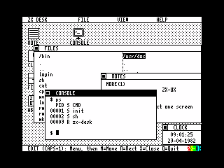</p>

---

## ZX-UX SDK — A UNIX development environment for the Spectrum

**FIVE COMPILERS. ASSEMBLER. LINKER. RVM. CASSETTE SOFTWARE.**

Write UNIX applications on a modern desktop and run them on a physical or emulated 48K Sinclair ZX Spectrum. The SDK follows the classic UNIX workflow: **edit, compile, assemble, link, test and load**.

Five language compilers share a Z80 toolchain. RVM runs the actual ZX-UX kernel while you work. The finished ZX-UX executables, whether native Z80 or bytecode-based, travel on cassette.

### Five compilers. One target.

- **C48 — `rcc`.** Compiles C (`.c`) to native Z80 or compact bytecode, with options that help programs fit into 48K.
- **Spectrum BASIC — `rbc`.** Compiles numbered `.bas` listings, or original `.tzx` tapes with matching BASIC source, into native executables.
- **Pascal — `rpc`.** Turns structured `.pas` programs into relocatable objects and linked ZX-UX executables.
- **FORTRAN — `rfortranc`.** Compiles supported FORTRAN 77 (`.f`, `.for`) through the C48 toolchain.
- **Forth — `rfc`.** Compiles `.fth` source with colon definitions, stack operations and an indirect-threaded runtime.

### Compile. Assemble. Link.

- **Separate compilation** — emits assembly with `-S` or relocatable object files with `-c` for later linking.
- **Z80 assembler (`ras`)** — produces object code with text, data and BSS sections, labels, global symbols and external references.
- **Link editor (`rld`)** — resolves symbols, applies relocations, sets the entry point and reserves stack and heap space.
- **Linker maps** — show the symbols and addresses in a linked program before it goes onto tape.
- **`.ssa` libraries** — bundle reusable `.sso` objects for the linker to select as needed.
- **C48 startup code** — `crt0` enters `main`, passes `argc` and `argv` and exits through the kernel.
- **C48 headers and runtime** — `#include <c48.h>` for UNIX-style file and process calls, `errno`, screen control and graphics.
- **C preprocessor** — supports `#include` and `#define` for sharing declarations and constants.

### Source files, objects and executables

- **`.c`, `.bas`, `.pas`, `.f` / `.for`, `.fth`** — source code for the five compilers.
- **`.s` / `.asm`** — generated or handwritten Z80 assembly.
- **`.sso` (SSO1)** — relocatable object modules for the linker.
- **`.ssa` (SSA1)** — libraries of object modules.
- **`.ssx` (SSX1)** — linked, relocatable ZX-UX executables with entry-point and memory information.
- **`.tzx`** — Spectrum cassette images carrying those executables.
- **Executable loader (`/etc/ldx`)** — reads an SSX1 program from cassette, allocates memory, relocates it and starts a ZX-UX process.

### RVM. A Spectrum emulator running real UNIX

- **Included 48K Spectrum emulator (`zxmachine.py`)** — powers RVM with Z80 execution, the Sinclair ROM, ULA frame timing, keyboard matrix, color display, border, beeper and cassette I/O.
- **Real ZX-UX boot** — loads the supplied system tape on the emulated machine and logs in; the kernel, shell and applications execute as Z80 code.
- **Cassette emulation** — supports fast ROM tape loading for development or pulse-timed playback through the original ROM.
- **Authentic execution** — programs use the ZX-UX shell, executable loader, scheduler and system calls rather than Python replacements.
- **Interactive and headless modes** — provide the Spectrum display and beeper or run repeatable tests without a window.
- **Input and output capture** — accepts keystrokes and records text, `.png` pictures, `.scr` screens, `.wav` sound or `.tzx` tape output.
- **Multitasking tests** — run background jobs under the actual ZX-UX kernel.

### Watch the fractal forest sway in the wind. Then put it on tape.

From the repository root, with Python 3 and a graphical desktop (Tk support):

```sh
python3 sdk/bin/rcc examples/c48-src/demos/forest.c
python3 sdk/bin/rvm --gui examples/c48-src/demos/forest.ssx
python3 sdk/bin/rtap -o forest.tzx examples/c48-src/demos/forest.ssx=forest
```

- **Compile** — `rcc` builds the bundled C48 Fractal Forest demo into `forest.ssx`.
- **Test** — `rvm --gui` boots ZX-UX and shows the fractal trees bending and swaying in the wind on a virtual Spectrum.
- **Package** — `rtap` creates `forest.tzx` and can also add programs to a ZX-UX boot tape.
- **Run on a Spectrum** — mount `forest.tzx` in an emulator or prepare its cassette audio for a physical machine. Boot ZX-UX, enter `/dev/cassette/forest` at the shell, then start playback.

### Software showcase — C48 applications and UNIX folklore

Four C48 applications show what the SDK can build beyond small demos:

<table>
<tr>
<td align="center"><a href="examples/c48-src/apps/write48.c">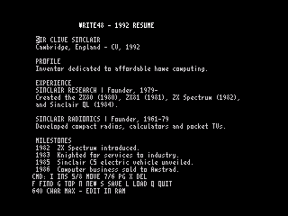</a><br><sub><a href="examples/c48-src/apps/write48.c"><code>write48.c</code></a></sub></td>
<td align="center"><a href="examples/c48-src/apps/wire3d.c">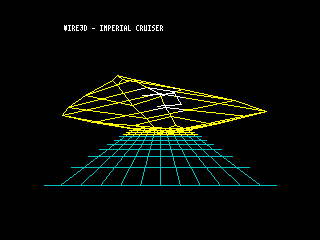</a><br><sub><a href="examples/c48-src/apps/wire3d.c"><code>wire3d.c</code></a></sub></td>
</tr>
<tr>
<td align="center"><a href="examples/c48-src/apps/sheet48.c">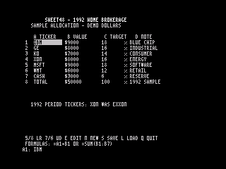</a><br><sub><a href="examples/c48-src/apps/sheet48.c"><code>sheet48.c</code></a></sub></td>
<td align="center"><a href="examples/c48-src/apps/gp82.c">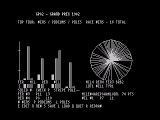</a><br><sub><a href="examples/c48-src/apps/gp82.c"><code>gp82.c</code></a></sub></td>
</tr>
</table>

**UNIX folklore, back on the screen.** C48 revives the spirit of early terminal games: [`trek`](examples/c48-src/games/trek.c) (Star Trek), [`rogue`](examples/c48-src/games/rogue.c) (dungeon crawl), [`advent`](examples/c48-src/games/advent.c) (text adventure), [`wump`](examples/c48-src/games/wump.c) (Hunt the Wumpus), [`snake`](examples/c48-src/games/snake.c) and [`fortune`](examples/c48-src/games/fortune.c). Each has a ZX-UX executable and cassette image.

**And then there's [Chess](examples/c48-src/games/chess.c).** The C48 program draws a graphical board using custom Spectrum characters. Play another person or choose a computer opponent as White or Black. Its **1–3-ply look-ahead** uses iterative deepening and alpha-beta search, displaying the nodes searched and the position score.

The engine enforces legal moves, including castling, en passant and all four pawn promotions. It also recognizes checkmate, stalemate and the 50-move rule. A proper chess engine, on a 48K Spectrum.

### Compiler screenshot showcases

Each gallery uses an actual FUSE capture of a compiled ZX-UX program. The compact image links to its source, and the filename below it identifies the program that produced the capture.

#### C48 — graphics and recursive demos

[Source programs](examples/c48-src/demos/) · [Compiled ZX-UX executables](examples/c48-bin/ssx/) · [Full FUSE gallery](screenshots/c48-bin/fuse/index.html)

<table>
<tr>
<td align="center"><a href="examples/c48-src/demos/forest.c">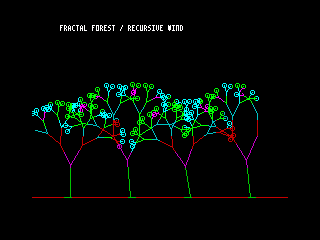</a><br><sub><a href="examples/c48-src/demos/forest.c"><code>forest.c</code></a></sub></td>
<td align="center"><a href="examples/c48-src/demos/mandel.c">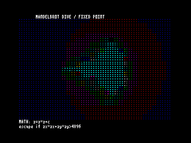</a><br><sub><a href="examples/c48-src/demos/mandel.c"><code>mandel.c</code></a></sub></td>
</tr>
<tr>
<td align="center"><a href="examples/c48-src/demos/julia.c">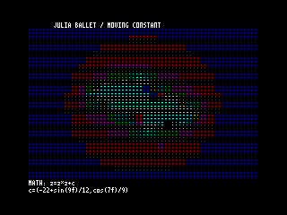</a><br><sub><a href="examples/c48-src/demos/julia.c"><code>julia.c</code></a></sub></td>
<td align="center"><a href="examples/c48-src/demos/plasma.c">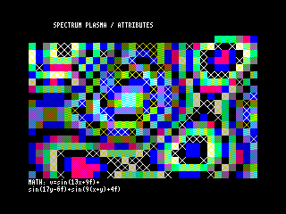</a><br><sub><a href="examples/c48-src/demos/plasma.c"><code>plasma.c</code></a></sub></td>
</tr>
<tr>
<td align="center"><a href="examples/c48-src/demos/kaleido.c">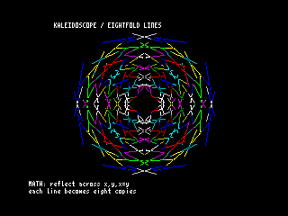</a><br><sub><a href="examples/c48-src/demos/kaleido.c"><code>kaleido.c</code></a></sub></td>
<td align="center"><a href="examples/c48-src/demos/torus.c">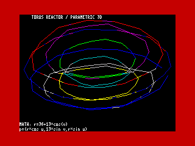</a><br><sub><a href="examples/c48-src/demos/torus.c"><code>torus.c</code></a></sub></td>
</tr>
<tr>
<td align="center"><a href="examples/c48-src/demos/tunnel.c">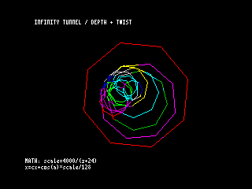</a><br><sub><a href="examples/c48-src/demos/tunnel.c"><code>tunnel.c</code></a></sub></td>
<td align="center"><a href="examples/c48-src/demos/raymaze.c">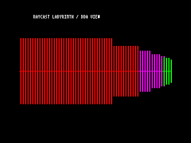</a><br><sub><a href="examples/c48-src/demos/raymaze.c"><code>raymaze.c</code></a></sub></td>
</tr>
<tr>
<td align="center"><a href="examples/c48-src/demos/hanoi.c"></a><br><sub><a href="examples/c48-src/demos/hanoi.c"><code>hanoi.c</code></a></sub></td>
<td align="center"><a href="examples/c48-src/demos/queens8.c">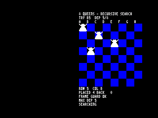</a><br><sub><a href="examples/c48-src/demos/queens8.c"><code>queens8.c</code></a></sub></td>
</tr>
</table>

#### Spectrum BASIC — compiled 1980s programs

[Source programs](examples/rbc-src/60-programs/) · [Compiled ZX-UX executables](examples/rbc-bin/60-programs/ssx/) · [Full FUSE gallery](screenshots/rbc-bin/fuse/index.html)

<table>
<tr>
<td align="center"><a href="examples/rbc-src/60-programs/01-minelay/01-minelay.bas">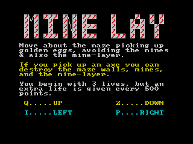</a><br><sub><a href="examples/rbc-src/60-programs/01-minelay/01-minelay.bas"><code>01-minelay.bas</code></a></sub></td>
<td align="center"><a href="examples/rbc-src/60-programs/06-motocross/06-motocross.bas">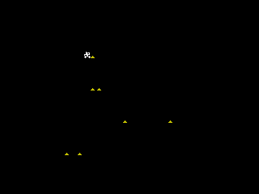</a><br><sub><a href="examples/rbc-src/60-programs/06-motocross/06-motocross.bas"><code>06-motocross.bas</code></a></sub></td>
</tr>
<tr>
<td align="center"><a href="examples/rbc-src/60-programs/25-galaxians/25-galaxians.bas">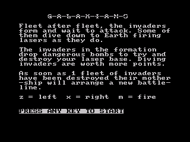</a><br><sub><a href="examples/rbc-src/60-programs/25-galaxians/25-galaxians.bas"><code>25-galaxians.bas</code></a></sub></td>
<td align="center"><a href="examples/rbc-src/60-programs/42-bricklayer/42-bricklayer.bas">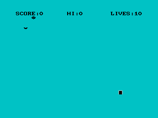</a><br><sub><a href="examples/rbc-src/60-programs/42-bricklayer/42-bricklayer.bas"><code>42-bricklayer.bas</code></a></sub></td>
</tr>
<tr>
<td align="center"><a href="examples/rbc-src/60-programs/43-dogfight/43-dogfight.bas">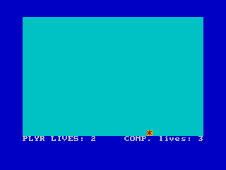</a><br><sub><a href="examples/rbc-src/60-programs/43-dogfight/43-dogfight.bas"><code>43-dogfight.bas</code></a></sub></td>
<td align="center"><a href="examples/rbc-src/60-programs/50-moonlander/50-moonlander.bas">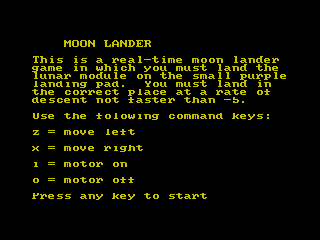</a><br><sub><a href="examples/rbc-src/60-programs/50-moonlander/50-moonlander.bas"><code>50-moonlander.bas</code></a></sub></td>
</tr>
<tr>
<td align="center"><a href="examples/rbc-src/60-programs/49-drag-racer/49-drag-racer.bas">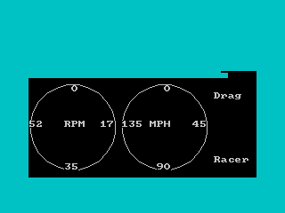</a><br><sub><a href="examples/rbc-src/60-programs/49-drag-racer/49-drag-racer.bas"><code>49-drag-racer.bas</code></a></sub></td>
<td align="center"><a href="examples/rbc-src/60-programs/30-space-traffic/30-space-traffic.bas">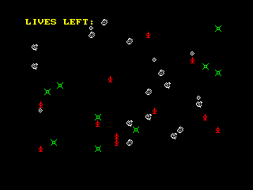</a><br><sub><a href="examples/rbc-src/60-programs/30-space-traffic/30-space-traffic.bas"><code>30-space-traffic.bas</code></a></sub></td>
</tr>
<tr>
<td align="center"><a href="examples/rbc-src/60-programs/33-heli-bomber/33-heli-bomber.bas">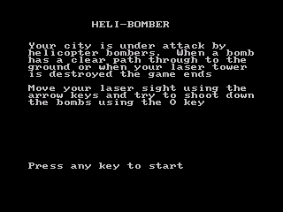</a><br><sub><a href="examples/rbc-src/60-programs/33-heli-bomber/33-heli-bomber.bas"><code>33-heli-bomber.bas</code></a></sub></td>
<td align="center"><a href="examples/rbc-src/60-programs/59-mushroom-invasion/59-mushroom-invasion.bas">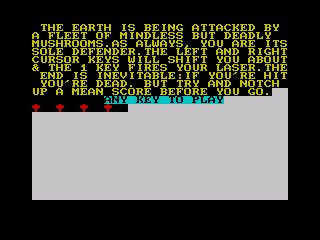</a><br><sub><a href="examples/rbc-src/60-programs/59-mushroom-invasion/59-mushroom-invasion.bas"><code>59-mushroom-invasion.bas</code></a></sub></td>
</tr>
</table>

#### Pascal — structured programs and numerical work

[Source programs](examples/pascal-src/samples/) · [Compiled ZX-UX executables](examples/pascal-bin/samples/ssx/) · [Full FUSE gallery](screenshots/pascal-bin/fuse/index.html)

<table>
<tr>
<td align="center"><a href="examples/pascal-src/samples/fibarray/fibarray.pas"></a><br><sub><a href="examples/pascal-src/samples/fibarray/fibarray.pas"><code>fibarray.pas</code></a></sub></td>
<td align="center"><a href="examples/pascal-src/samples/fiblarge/fiblarge.pas">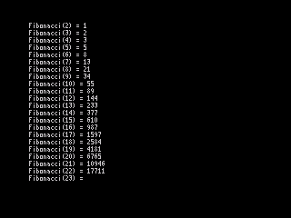</a><br><sub><a href="examples/pascal-src/samples/fiblarge/fiblarge.pas"><code>fiblarge.pas</code></a></sub></td>
</tr>
<tr>
<td align="center"><a href="examples/pascal-src/samples/fibopt/fibopt.pas">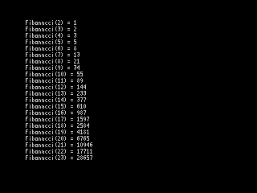</a><br><sub><a href="examples/pascal-src/samples/fibopt/fibopt.pas"><code>fibopt.pas</code></a></sub></td>
<td align="center"><a href="examples/pascal-src/samples/numerical-analysis/factorial/factorial.pas">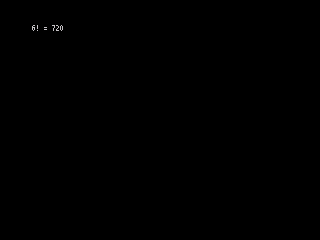</a><br><sub><a href="examples/pascal-src/samples/numerical-analysis/factorial/factorial.pas"><code>factorial.pas</code></a></sub></td>
</tr>
<tr>
<td align="center"><a href="examples/pascal-src/samples/numerical-analysis/prime/prime.pas"></a><br><sub><a href="examples/pascal-src/samples/numerical-analysis/prime/prime.pas"><code>prime.pas</code></a></sub></td>
<td align="center"><a href="examples/pascal-src/samples/numerical-analysis/burksort/burksort.pas">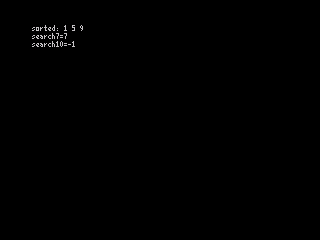</a><br><sub><a href="examples/pascal-src/samples/numerical-analysis/burksort/burksort.pas"><code>burksort.pas</code></a></sub></td>
</tr>
<tr>
<td align="center"><a href="examples/pascal-src/samples/numerical-analysis/burkmm/burkmm.pas"></a><br><sub><a href="examples/pascal-src/samples/numerical-analysis/burkmm/burkmm.pas"><code>burkmm.pas</code></a></sub></td>
<td align="center"><a href="examples/pascal-src/samples/numerical-analysis/machar/machar.pas">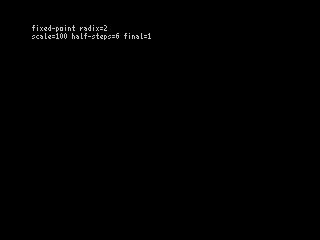</a><br><sub><a href="examples/pascal-src/samples/numerical-analysis/machar/machar.pas"><code>machar.pas</code></a></sub></td>
</tr>
<tr>
<td align="center"><a href="examples/pascal-src/samples/numerical-analysis/burkgcd/burkgcd.pas">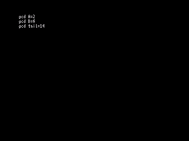</a><br><sub><a href="examples/pascal-src/samples/numerical-analysis/burkgcd/burkgcd.pas"><code>burkgcd.pas</code></a></sub></td>
<td align="center"><a href="examples/pascal-src/samples/numerical-analysis/burkprime/burkprime.pas"></a><br><sub><a href="examples/pascal-src/samples/numerical-analysis/burkprime/burkprime.pas"><code>burkprime.pas</code></a></sub></td>
</tr>
</table>

#### FORTRAN — numerical and scientific computing

[Source programs](examples/fortran-src/samples/) · [Compiled ZX-UX executables](examples/fortran-bin/samples/ssx/) · [Full FUSE gallery](screenshots/fortran-bin/fuse/index.html)

<table>
<tr>
<td align="center"><a href="examples/fortran-src/samples/numerical-analysis/na_fft.f">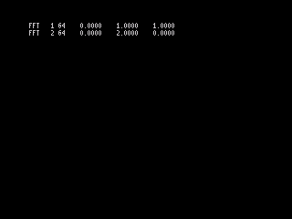</a><br><sub><a href="examples/fortran-src/samples/numerical-analysis/na_fft.f"><code>na_fft.f</code></a></sub></td>
<td align="center"><a href="examples/fortran-src/samples/numerical-analysis/na_gemm.f">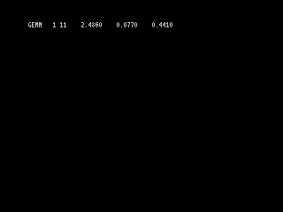</a><br><sub><a href="examples/fortran-src/samples/numerical-analysis/na_gemm.f"><code>na_gemm.f</code></a></sub></td>
</tr>
<tr>
<td align="center"><a href="examples/fortran-src/samples/numerical-analysis/na_cholesky.f">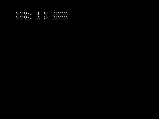</a><br><sub><a href="examples/fortran-src/samples/numerical-analysis/na_cholesky.f"><code>na_cholesky.f</code></a></sub></td>
<td align="center"><a href="examples/fortran-src/samples/numerical-analysis/na_lupivot.f">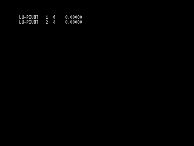</a><br><sub><a href="examples/fortran-src/samples/numerical-analysis/na_lupivot.f"><code>na_lupivot.f</code></a></sub></td>
</tr>
<tr>
<td align="center"><a href="examples/fortran-src/samples/numerical-analysis/na_rk4.f">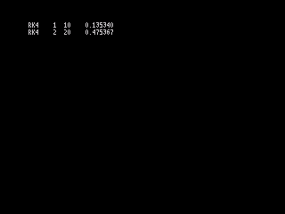</a><br><sub><a href="examples/fortran-src/samples/numerical-analysis/na_rk4.f"><code>na_rk4.f</code></a></sub></td>
<td align="center"><a href="examples/fortran-src/samples/numerical-analysis/na_newton.f"></a><br><sub><a href="examples/fortran-src/samples/numerical-analysis/na_newton.f"><code>na_newton.f</code></a></sub></td>
</tr>
<tr>
<td align="center"><a href="examples/fortran-src/samples/numerical-analysis/na_romberg.f">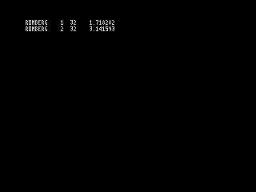</a><br><sub><a href="examples/fortran-src/samples/numerical-analysis/na_romberg.f"><code>na_romberg.f</code></a></sub></td>
<td align="center"><a href="examples/fortran-src/samples/numerical-analysis/na_polyfit.f">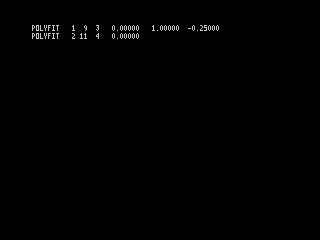</a><br><sub><a href="examples/fortran-src/samples/numerical-analysis/na_polyfit.f"><code>na_polyfit.f</code></a></sub></td>
</tr>
<tr>
<td align="center"><a href="examples/fortran-src/samples/burkardt/f77s_burksort.f">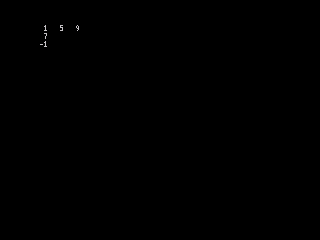</a><br><sub><a href="examples/fortran-src/samples/burkardt/f77s_burksort.f"><code>f77s_burksort.f</code></a></sub></td>
<td align="center"><a href="examples/fortran-src/samples/numerical-analysis/na_whet.f">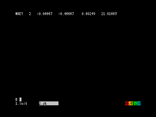</a><br><sub><a href="examples/fortran-src/samples/numerical-analysis/na_whet.f"><code>na_whet.f</code></a></sub></td>
</tr>
</table>

#### Forth — stacks, words and algorithms

[Source programs](examples/forth-src/) · [Compiled ZX-UX executables](examples/forth-bin/ssx/) · [Full FUSE gallery](screenshots/forth-bin/fuse/index.html)

<table>
<tr>
<td align="center"><a href="examples/forth-src/examples/worms.fth">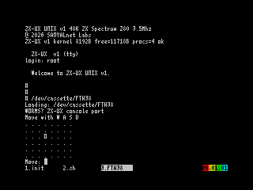</a><br><sub><a href="examples/forth-src/examples/worms.fth"><code>worms.fth</code></a></sub></td>
<td align="center"><a href="examples/forth-src/examples/calendar.fth">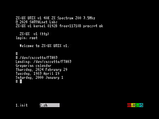</a><br><sub><a href="examples/forth-src/examples/calendar.fth"><code>calendar.fth</code></a></sub></td>
</tr>
<tr>
<td align="center"><a href="examples/forth-src/numerical-analysis/tinyfft.fth">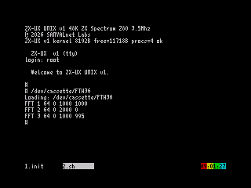</a><br><sub><a href="examples/forth-src/numerical-analysis/tinyfft.fth"><code>tinyfft.fth</code></a></sub></td>
<td align="center"><a href="examples/forth-src/examples/pfbench.fth">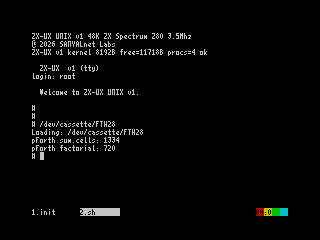</a><br><sub><a href="examples/forth-src/examples/pfbench.fth"><code>pfbench.fth</code></a></sub></td>
</tr>
<tr>
<td align="center"><a href="examples/forth-src/examples/pfsieve.fth">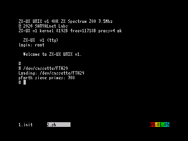</a><br><sub><a href="examples/forth-src/examples/pfsieve.fth"><code>pfsieve.fth</code></a></sub></td>
<td align="center"><a href="examples/forth-src/examples/hufdemo.fth">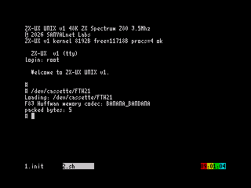</a><br><sub><a href="examples/forth-src/examples/hufdemo.fth"><code>hufdemo.fth</code></a></sub></td>
</tr>
<tr>
<td align="center"><a href="examples/forth-src/numerical-analysis/gemm8bit.fth">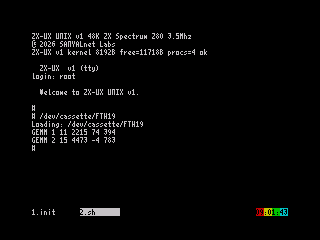</a><br><sub><a href="examples/forth-src/numerical-analysis/gemm8bit.fth"><code>gemm8bit.fth</code></a></sub></td>
<td align="center"><a href="examples/forth-src/numerical-analysis/bisect.fth">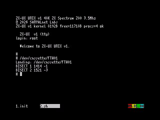</a><br><sub><a href="examples/forth-src/numerical-analysis/bisect.fth"><code>bisect.fth</code></a></sub></td>
</tr>
<tr>
<td align="center"><a href="examples/forth-src/numerical-analysis/cholesky.fth">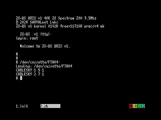</a><br><sub><a href="examples/forth-src/numerical-analysis/cholesky.fth"><code>cholesky.fth</code></a></sub></td>
<td align="center"><a href="examples/forth-src/numerical-analysis/whetston.fth">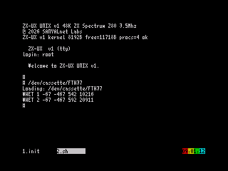</a><br><sub><a href="examples/forth-src/numerical-analysis/whetston.fth"><code>whetston.fth</code></a></sub></td>
</tr>
</table>

### Next Steps

Our accompanying book, [*The Design of the ZX-UX Operating System*](docs/Design_of_the_ZX-UX_Operating_System.pdf), is meant to be opened wherever your interests lead. **Section 1, Installing and Using ZX-UX** shows how to boot the machine, use the shell and run the supplied programs. **Section 2, The Compilers** covers writing software in five languages. **Section 3, ZX-UX Architecture** traces the boot code, system calls, scheduler, memory and file system. Section 1 also has a short command reference for when the spelling escapes you.

ZX-UX began in [Supratim Sanyal](https://supratim-sanyal.blogspot.com/)'s Spectrum notebooks. Sinclair BASIC gave way to Z80 machine code and, by the late 1980s, plans for a UNIX kernel. Work and family put the project on hold. Decades later, retirement made room to finish it. Guided by classic UNIX books and Erdogan Tan's Retro UNIX as a design reference, we built a fresh Z80 implementation. The kernel occupies 8K on a machine with 48K RAM. Every byte had to earn its place.

Students of **operating-system and compiler design** can follow working code from boot to processes, files and five language toolchains. Readers drawn to computing history, UNIX legends and folklore will recognize familiar commands and classic game traditions. The code is small enough to study end to end, including the hard parts that diagrams have a habit of leaving out.

There is plenty left to try: port ZX-UX to other computers of its era, build a new kernel for another processor, or use its ideas as the starting point for a modern UNIX-like system. Linus Torvalds began Linux in 1991. ZX-UX offers another small place to begin. The hardware may change; the bugs still expect correct addresses.

See the [non-commercial project license](LICENSE) and [third-party notices](THIRD-PARTY) for use and attribution terms.

**WRITE ON A DESKTOP. TEST UNDER UNIX. RUN ON A SPECTRUM.**
